# Control Network Access Point 
This guide explains how to configure a NETGEAR router (Nighthawk AX1800 **RAX10**) as the access point (AP) for the lab's control network. The control network must be on the **same subnet as the Testbed Controller** (`10.1.1.0/24`) so the controller and all devices can communicate directly.

Because UMB campus Wi-Fi operates mostly in the **2.4 GHz band**, the control network uses **only the 5 GHz band**. The 2.4 GHz radio is disabled to avoid interference.

---

## Target Configuration

| Setting | Value |
|---|---|
| SSID (5 GHz) | `ucanlab_control-5G` |
| Wi-Fi password | `greenpear2020` |
| Security | WPA2-Personal (AES) |
| Router (LAN) IP | `10.1.1.2` |
| Subnet mask | `255.255.255.0` (`/24`) |
| 5 GHz channel | `149` |
| DHCP range | `10.1.1.100` – `10.1.1.210` |
| DHCP lease time | 24 hours |
| Admin username | `admin` |
| Admin password | `LightComms5556` |
| Security questions | Both answers: `Boston` |

---

## 1. Access the Router Web Interface

### 1.1 Find the router's IP address (default gateway)

Connect your PC to the router (Ethernet or its default Wi-Fi), then:

- **Windows:** open Command Prompt (`cmd`) and run:
  
    - `ipconfig`
  
  Under the adapter connected to the router, read the **Default Gateway** — this is the router's IP (factory default is usually `192.168.1.1`).

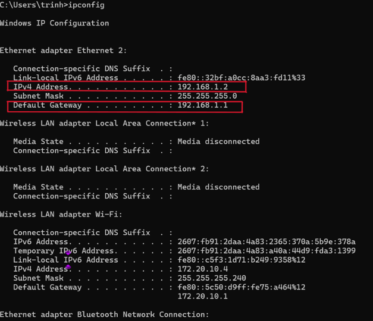
- **Linux:**
  
- `ip route | grep default`
  
### 1.2 Open the setup page

1. Enter the router IP (e.g., `http://192.168.1.1`) in your browser's **address bar** (not a search bar).
2. On **Configuring Your Internet Connection**, select **"No, manually enter settings"** and click **NEXT**.

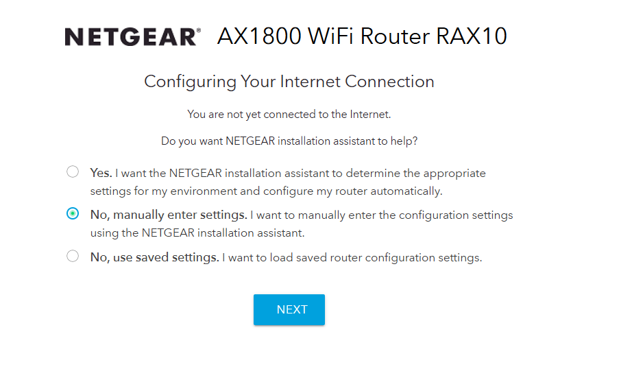

### 1.3 Set admin credentials

On **Admin Account Settings**:

| Field | Value |
|---|---|
| Username | `admin` (fixed) |
| New password | `LightComms5556` |
| Security Question #1 | *In what city were you born?* → `Boston` |
| Security Question #2 | *In what city was your father born?* → `Boston` |

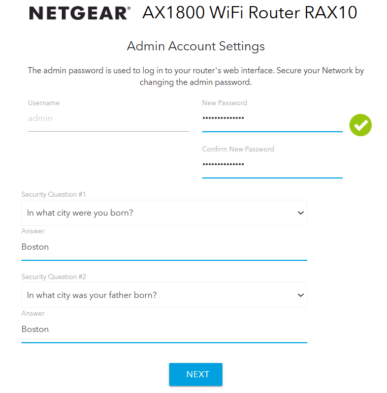

Click **NEXT**. The page reloads and prompts you to sign in — use `admin` and the new password to open the router settings.

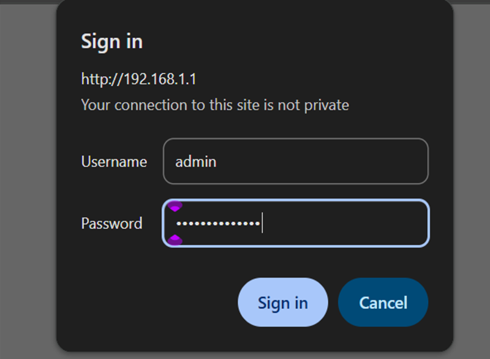

> The browser may warn *"Your connection to this site is not private."* This is expected for the router's local HTTP page.

---

## 2. Configure Wireless Settings (2.4 GHz and 5 GHz)

Go to **ADVANCED → Setup → Wireless Setup**.

### 2.1 2.4 GHz network

1. **Uncheck** *Enable SSID Broadcast* (hides the network name).
2. **Uncheck** *Enable 20/40 MHz Coexistence*.
3. Set **Name (SSID)** to `ucanlab_control`.
4. Under **Security Options**, select **WPA2-Personal [AES]** and set **Password (Network Key)** to `greenpear2020`.
5. Click **Apply**.

| Before | After |
|---|---|
| 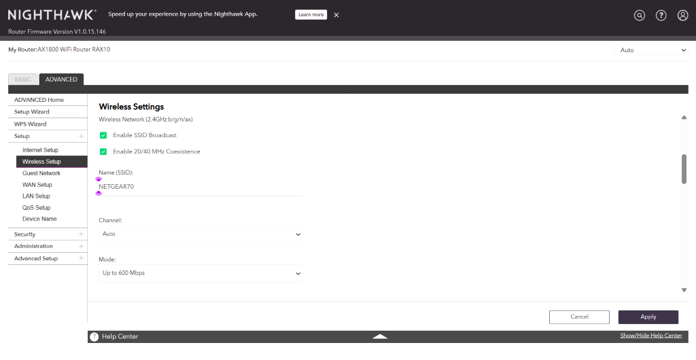 | 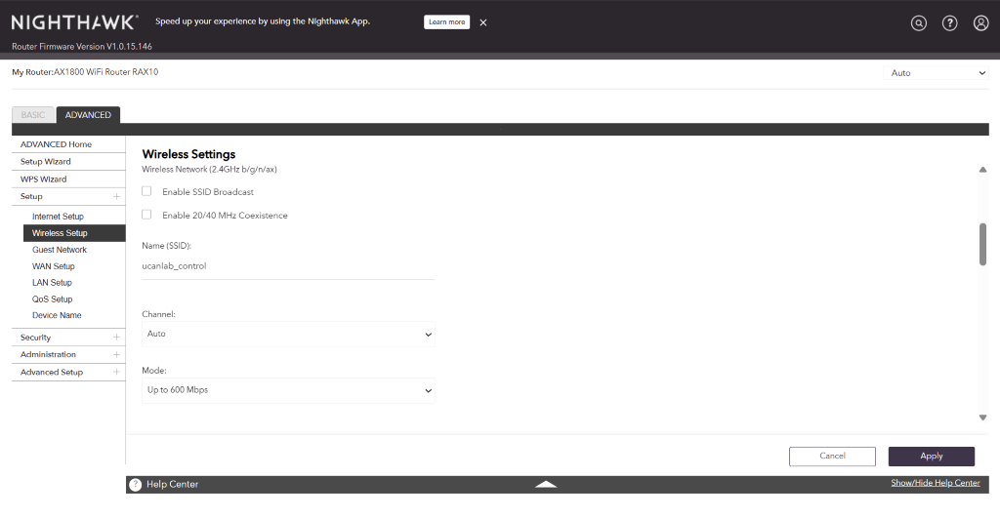 |
| 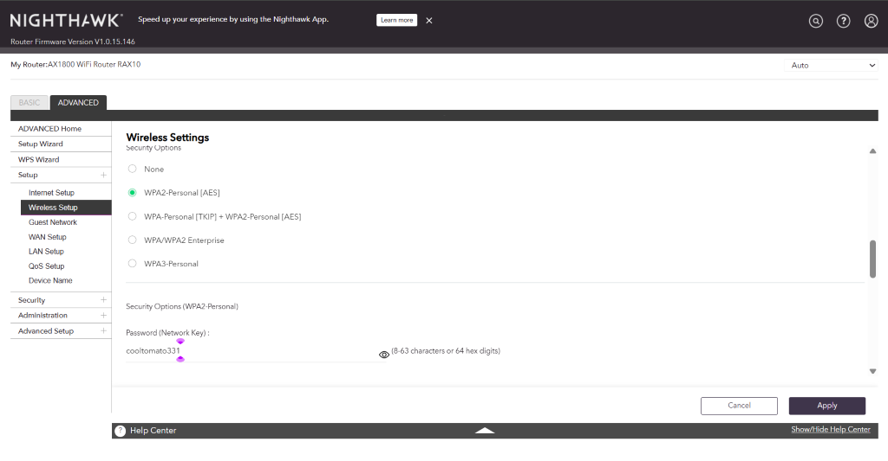 |  |

> Note: disabling 20/40 MHz Coexistence only affects channel width; it does not hide the network. Hiding is done by disabling SSID Broadcast, and the 2.4 GHz radio is fully turned off in [Step 5](#5-disable-the-24-ghz-radio).

### 2.2 5 GHz network

1. Leave *Enable SSID Broadcast* **checked**.
2. Set **Name (SSID)** to `ucanlab_control-5G`.
3. Set **Channel** to `149` so it does not overlap with nearby routers using the same channel.
4. Leave **Mode** at *Up to 1200 Mbps*.
5. Under **Security Options**, select **WPA2-Personal [AES]** and set **Password (Network Key)** to `greenpear2020`.
6. Click **Apply**.

| Before | After |
|---|---|
| 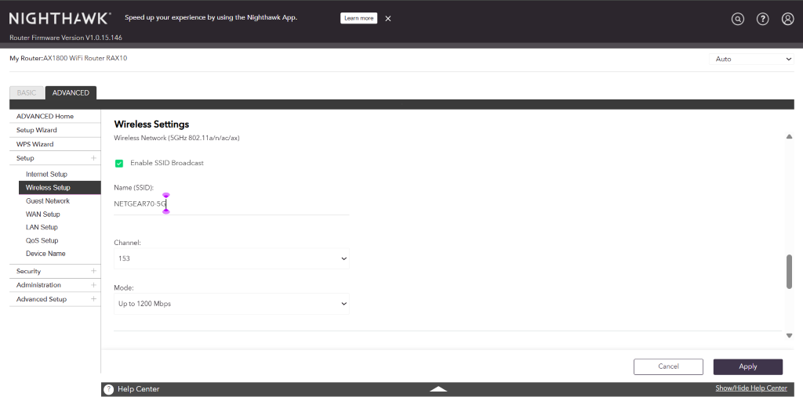 | 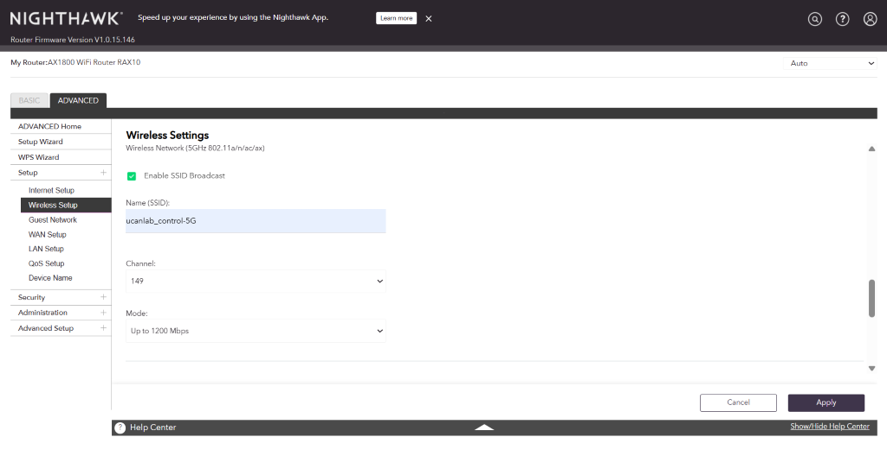 |
| 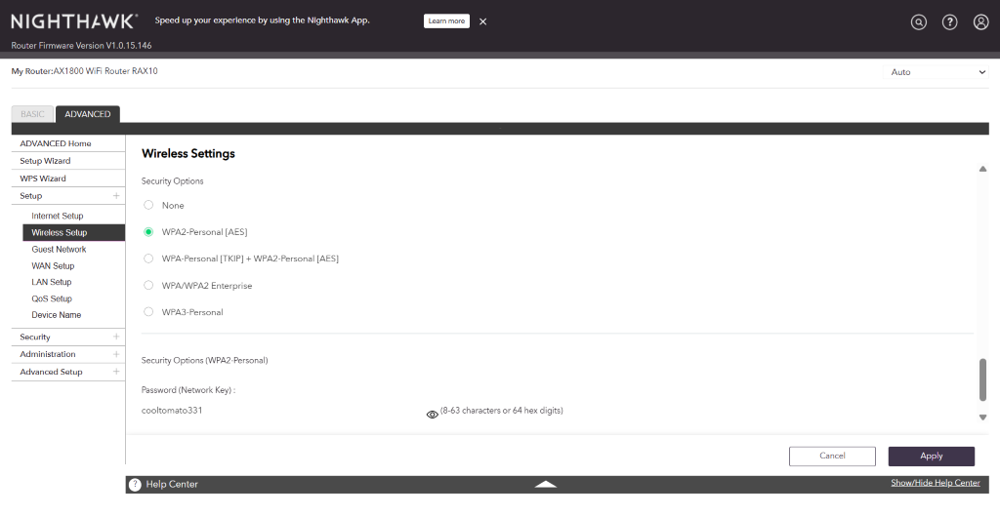 | 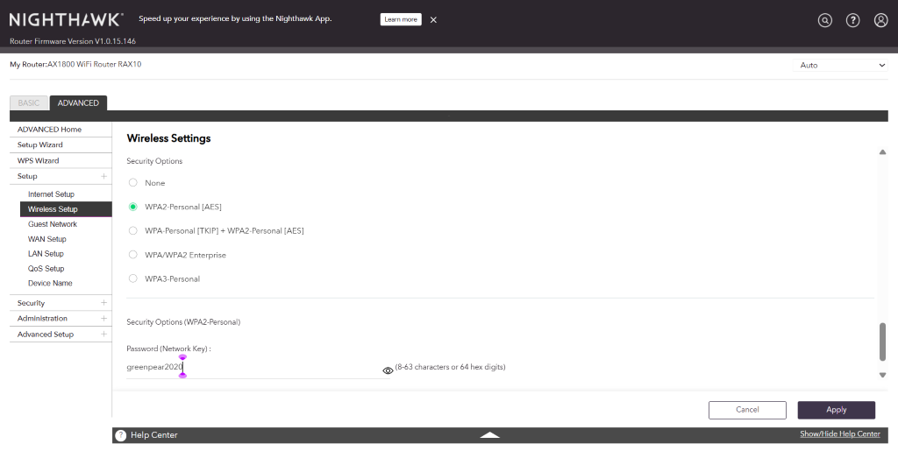 |

---

## 3. Configure Guest Networks

Go to **ADVANCED → Setup → Guest Network**.

### 3.1 2.4 GHz guest network

1. Set **Guest Wireless Network Name (SSID)** to `ucanlab_control-Guest`.
2. **Uncheck** *Enable SSID Broadcast*.
3. Set the password to `greenpear2020` under **Security Options**.
4. Click **Apply**.

| Before | After |
|---|---|
| 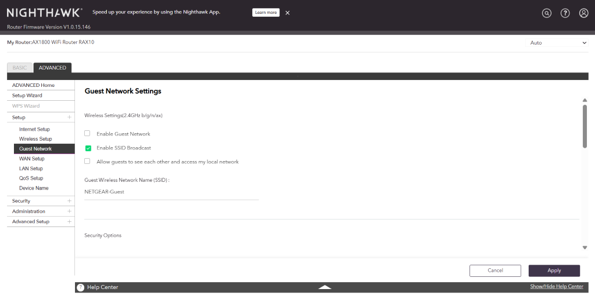 | 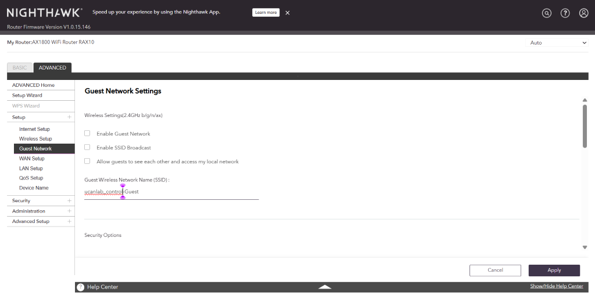 |

### 3.2 5 GHz guest network

1. Set **Guest Wireless Network Name (SSID)** to `ucanlab_control-5G-Guest`.
2. Set the password to `greenpear2020` under **Security Options**.
3. Click **Apply**.

| Before | After |
|---|---|
| 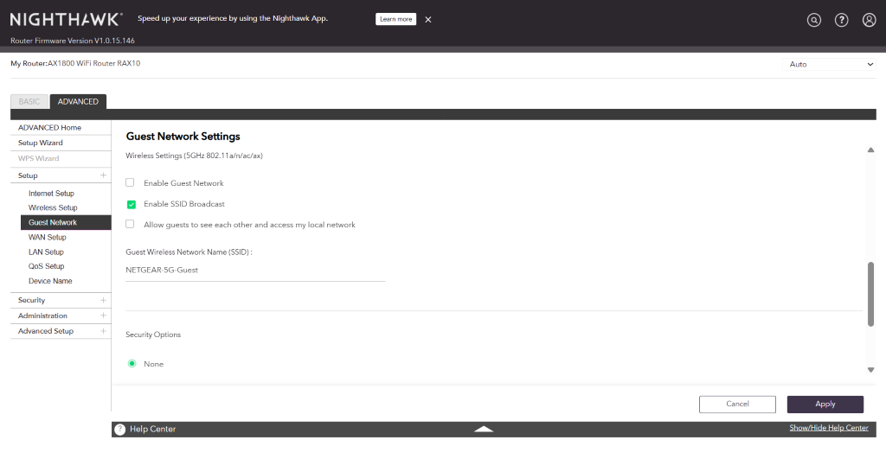 | 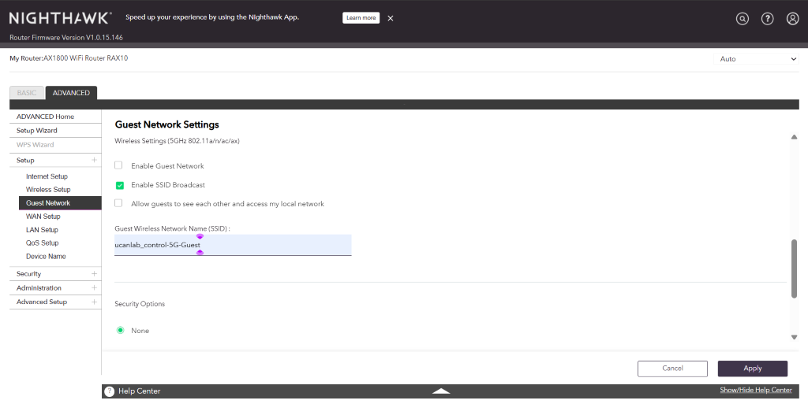 |

> In the reference screenshots, *Enable Guest Network* is left **unchecked**, so the guest networks stay off. Renaming them only keeps the naming consistent if they are ever enabled. If you do enable them, set security to **WPA2-Personal [AES]** (the default is **None**).

---

## 4. Configure LAN IP and DHCP

Go to **ADVANCED → Setup → LAN Setup**.

### 4.1 Router IP and subnet mask

1. Set **IP Address** to `10.1.1.2`.
2. Set **IP Subnet Mask** to `255.255.255.0`.
3. Click **Apply**.

| Before | After |
|---|---|
| 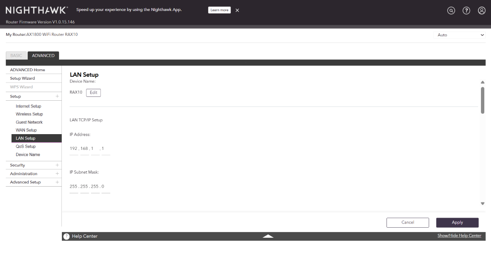 | 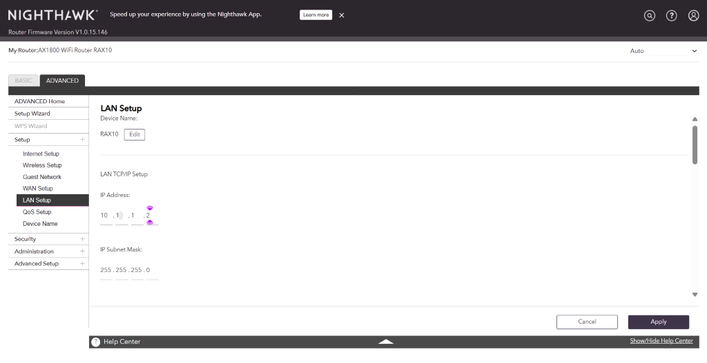 |

The router moves to the new address and the page will stop responding. Reconnect and renew your PC's IP so it gets a `10.1.1.x` address (Windows: `ipconfig /release` then `ipconfig /renew`), then sign in again at `http://10.1.1.2`.

### 4.2 DHCP server range

1. Make sure **Use Router as DHCP Server** is **checked**.
2. Set **Starting IP Address** to `10.1.1.100`.
3. Set **Ending IP Address** to `10.1.1.210`.
4. Leave **DHCP Lease Time** at `24` hours.
5. Click **Apply**.

| Before | After |
|---|---|
| 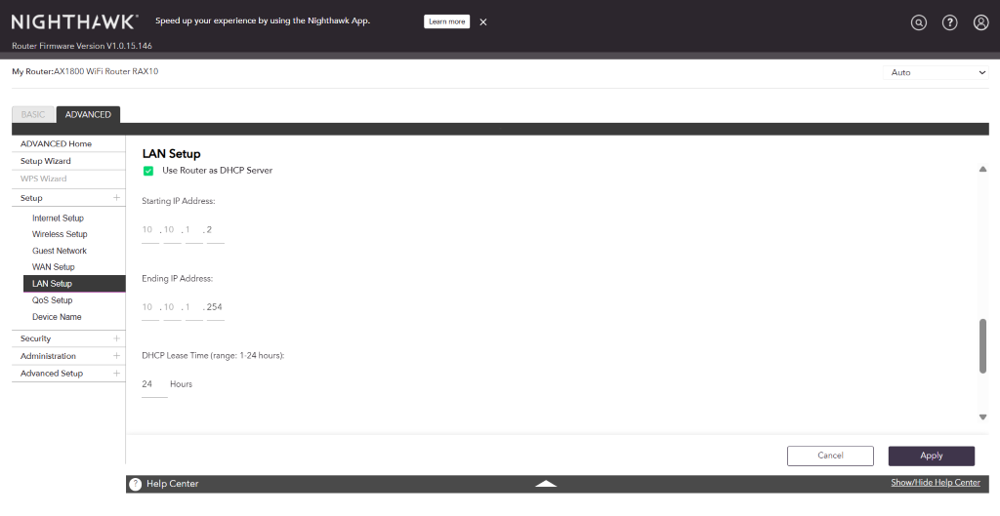 | 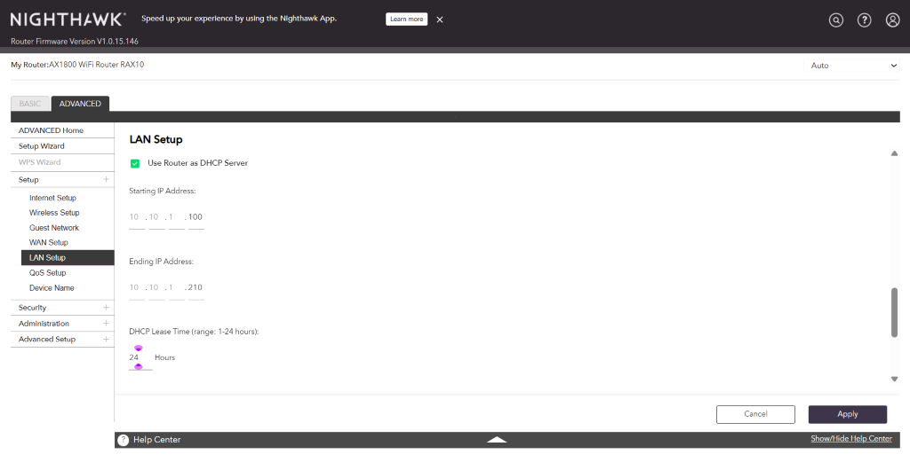 |

New devices receive addresses from this pool starting at `10.1.1.100` (e.g., `10.1.1.101`, `10.1.1.102`, …), up to `10.1.1.210` (111 addresses).

> Devices with **static IPs** (e.g., the Testbed Controller) should use addresses **outside** this range to avoid conflicts.

---

## 5. Disable the 2.4 GHz Radio

Go to **ADVANCED → Advanced Setup → Wireless Settings**.

1. Under **Advanced Wireless Settings (2.4 GHz b/g/n/ax)**, **uncheck** *Enable Wireless Router Radio*.
2. Click **Apply**.

| Before | After |
|---|---|
| 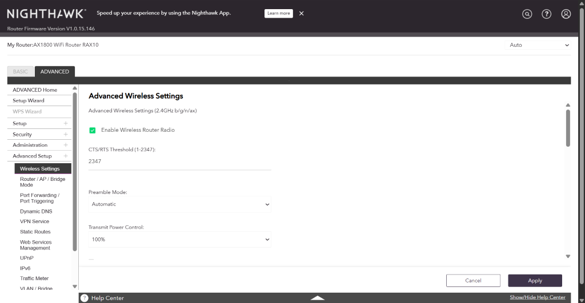 | 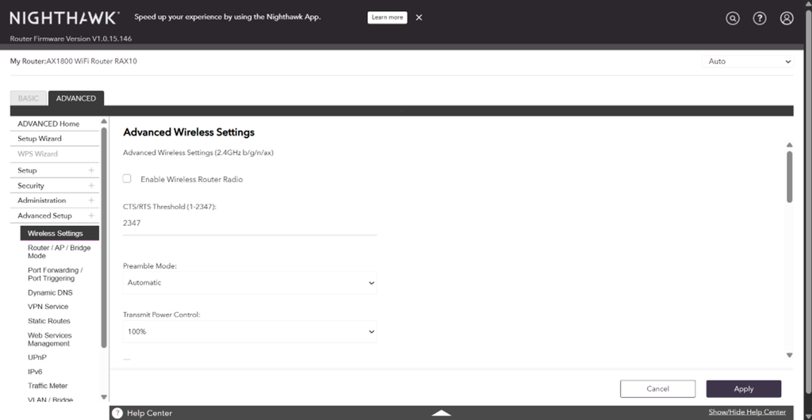 |

The router now transmits **only on 5 GHz**. This is required because the lab uses 5 GHz exclusively, while UMB campus Wi-Fi operates mainly on 2.4 GHz.

---

## Verification

- Only `ucanlab_control-5G` is visible in Wi-Fi scans (no 2.4 GHz network).
- Router web UI is reachable at `http://10.1.1.2`.
- A new device gets an IP in `10.1.1.100`–`10.1.1.210`.
- The Testbed Controller can ping a device on the network:
  - `ping 10.1.1.2`
