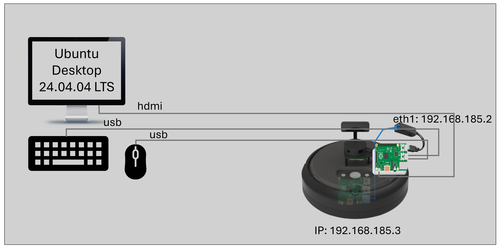
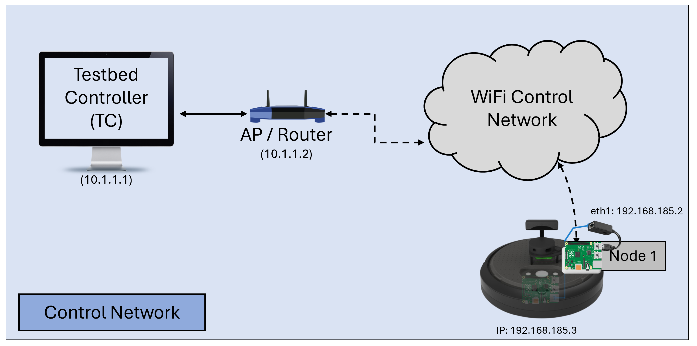
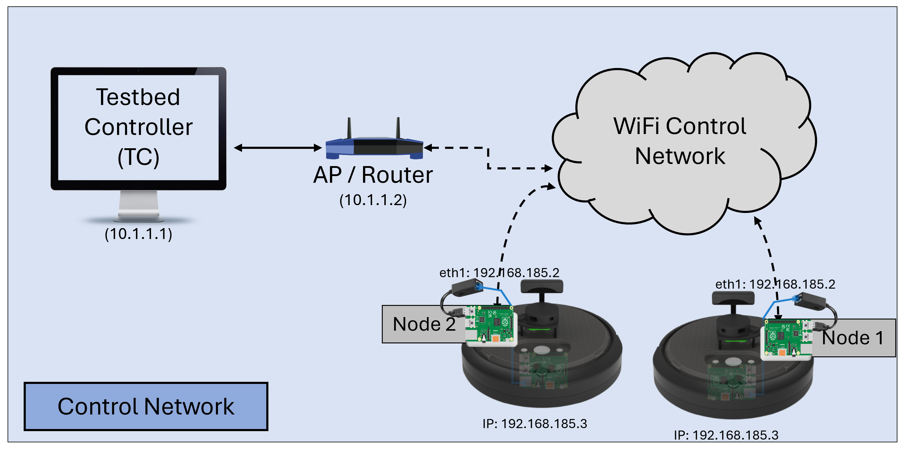

# Integrating TurtleBot 4 Mobility into the Testbed Controller (TC)

## Overview

This document explains how to integrate mobility into our Testbed Controller (TC) architecture, building on the setup from the previous chapter, [Setting Up TurtleBot 4](https://github.com/Utin0313/research/blob/main/01_Setup_TB4.md). This extension adds a framework for a dynamic testbed, where RPi nodes can run tests with a quasi-static movement profile (e.g., forward, rotate) for data collection (e.g., iperf, RSSI, raw I/Q).

The base architecture consists of a TurtleBot 4 (TB4), developed by Clearpath Robotics, an Ethernet cable for a simple network connection, a USB-to-Ethernet adapter, RPi nodes for overhead communication, and access points (APs). Because this is the latest extension developed by the lab, we assume you have read the previous chapters, understand the core idea of the testbed and its setup, and have already set up the TC as intended:

* Testbed Architecture (Chap. 0)
* Setting Up the TC (Chap. 1)
* Setting Up RPi Nodes (Chap. 2)
* Control Network Configuration (Chap. 3)
* Test Network Configuration (Chap. 4)

For further questions and debugging, see our Q&A section [section/link].

---

## Single-Node TB4 with Overhead RPi Controller

The image above shows a basic single-node TB4 with an Overhead RPi Controller, set up by following the installation process in [Setting Up TurtleBot 4](https://github.com/Utin0313/research/blob/main/01_Setup_TB4.md). The Overhead Pi has **username: ucanlab** and **IP: 10.1.1.X**, while the TB4's Pi has the default **username: ubuntu** and **IP: 192.168.185.3**. The USB-to-Ethernet adapter on the Overhead Pi uses the static IP **192.168.185.2** to connect the Overhead Pi to the TB4's Pi (as shown in the image above). If you have followed the previous chapter, [Setting Up TurtleBot 4](https://github.com/Utin0313/research/blob/main/01_Setup_TB4.md), and all the verification checks passed, you can now interact with the TB4 using the simple movement scripts we have already built (`move_forward.py` and `rotate.py`).

Since these movement scripts are already developed, running them is a third verification check. In the Overhead Pi's terminal, use `cd` to enter the directory that contains the scripts, then run:

* For a simple forward movement (move forward 0.5 m at a speed of 0.1 m/s):
    * `python3 move_forward.py --ros-args -p distance:=0.5 -p speed:=0.1`

* For a simple rotation (rotate 90° at an angular speed of 0.5 rad/s):
    * `python3 rotate.py --ros-args -p angle_deg:=90.0 -p angular_speed:=0.5`

### Video Demonstration

<video src="./Images/TB4_MoveForward.mp4" controls width="100%"></video>

*Video 1: `move_forward.py` run on the Overhead Pi (right) and the TB4's response (left).*

<video src="./Images/TB4_Rotate.mp4" controls width="100%"></video>

*Video 2: `rotate.py` run on the Overhead Pi (right) and the TB4's response (left).*

## Single-Node TB4 with Testbed Controller (TC)

This section extends the previous one. Instead of controlling the TB4 directly from the Overhead Pi, we now link our Testbed Controller (TC) on top of the Overhead Pi, so that tests are scalable, repeatable, and automated, as our lab intends. To do this, we need to add the Overhead Pi to our control network (`ucanlab_control`), which assigns addresses with DHCP (see [Control Network Access Point](https://github.com/Utin0313/research/blob/main/01_Control_Network.md)). To add the Overhead Pi, we reserve its IP using its Medium Access Control (MAC) address. There are two ways to find the MAC address: follow the instructions in Chapter 3 (i.e., with the core Testbed_Controller GitHub repo cloned), or type `cat /sys/class/net/wlan0/address` in the Overhead Pi's terminal, which prints the Pi's MAC address. Enter this MAC address and the IP assigned to the Overhead Pi in the control network router, then click Apply (see the image below for details).

[... Image Slot]

The TC has the default **IP: 10.1.1.1** and is already connected to the control network (see Chapter 1). To verify that the TC can reach the Overhead Pi, run `bash verify_nodes.sh` on the TC; the Overhead Pi's status will appear as `up` if everything is set up correctly. Next, enable passwordless SSH from the TC to the Overhead Pi (see Chap. 3). Assuming an SSH key has already been generated on the TC, type:

* `ssh-copy-id -i ~/.ssh/id_ed25519 ucanlab@10.1.1.X`

After enabling passwordless SSH, the process is the same as in the previous section, since we are now working on the Overhead Pi over SSH: 
* Run `ssh ucanlab@10.1.1.X` $\rightarrow$ activate ROS 2 Jazzy with `source /opt/ros/jazzy/setup.bash` $\rightarrow$ `cd` into the scripts directory $\rightarrow$ Run `python3 move_forward.py --ros-args -p distance:=0.5 -p speed:=0.1` or `python3 rotate.py --ros-args -p angle_deg:=90.0 -p angular_speed:=0.5`.

### Video Demonstration

[... Video Slot]

## Multi-Node TB4 with Testbed Controller (TC)

Since the control network can host up to 100 devices, we can also use multiple TB4s to enhance our data collection. As in the previous section, set up another Overhead Pi and TB4 (see [Setting Up TurtleBot 4](https://github.com/Utin0313/research/blob/main/01_Setup_TB4.md)), giving the new TB4 the same `ROS_DOMAIN_ID` but a different `ROBOT_NAMESPACE` (e.g., `/tb_02`). Then find the second Overhead Pi's MAC address by running `cat /sys/class/net/wlan0/address` in its terminal, and save this MAC address and its IP in the control network router (see [Control Network Access Point](https://github.com/Utin0313/research/blob/main/01_Control_Network.md)).

To check that all the Overhead Pi nodes are synchronized:
* cd into the script directory $\rightarrow$ run the built-in script `python3 grid_walk.py -m 2 -n 2`.

### Video Demonstration

[... Video Slot]

---

## Abbreviations

* Access Point (AP)
* Dynamic Host Configuration Protocol (DHCP)
* Internet Protocol (IP)
* Medium Access Control (MAC)
* Raspberry Pi (RPi)
* Robot Operating System (ROS)
* Secure Shell (SSH)
* Testbed Controller (TC)
* TurtleBot 4 (TB4)