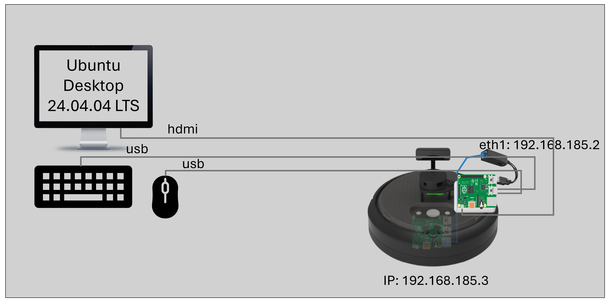
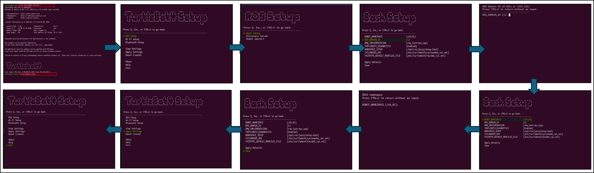
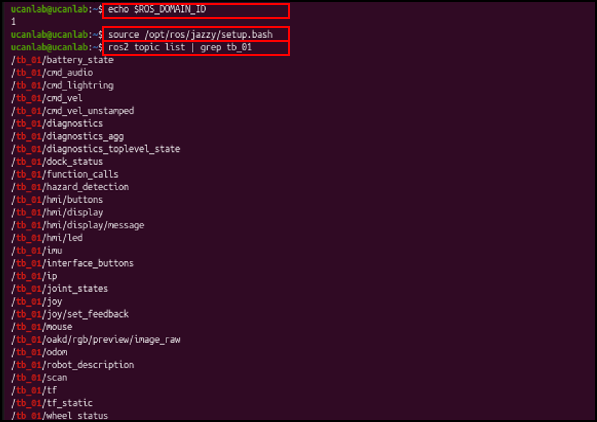

# Setting Up TurtleBot 4

## Overview

This document explains the installation process needed to operate the TurtleBot 4 (TB4) from *Clearpath Robotics*, as well as how to set up the Overhead Pi, which handles communication between the TB4 and the Testbed Controller (TC). With this setup, the Overhead Pi acts as the link between the TB4 and the TC, which lays the groundwork for the multi-node integration introduced in the next chapter.

In this document, we assume the TB4 is fully set up with ROS 2 Jazzy Jalisco (i.e., the Robot Operating System distribution that targets Ubuntu 24.04 LTS) and the Create 3 (i.e., the iRobot mobile base, whose firmware handles the motors, sensors, etc.) [section/link]. The instructions below will be easier to follow if you have read the previous chapters, so we strongly recommend reading the TC chapters (Chapter 2 and Chapter 3) first.

The table below lists the **requirements** (hardware, software, and lab-specific configuration) for the TB4 and the Overhead Pi.

---

## Requirements

|          | Overhead Pi                                                  | TB4's Pi                            |
|   ---    |                     ---                                      |                ---                  |
| Hardware | Raspberry Pi 4 Model B                                       | Raspberry Pi 4 Model B              |
| OS       | Ubuntu Desktop 24.04.5 LTS (64-bit)                          | Ubuntu Server 24.04.5 LTS (64-bit)  |
| Username | ucanlab                                                      | ubuntu                              |
| IP       | 10.1.1.X (lab network), 192.168.185.2 (wired link to TB4)    | 192.168.185.3                       |
| ROS 2    | Jazzy Jalisco                                                | Jazzy Jalisco                       |

---

## Mobility Architecture

The base mobility architecture is shown below. To stay consistent with our lab's network configuration (see Chapter 2), we keep the usernames and Internet Protocol (IP) addresses fixed: **username: ucanlab**, **IP: 10.1.1.X** for the Overhead Pi, and **username: ubuntu**, **IP: 192.168.185.3** for the TB4's Pi. The primary objective of this chapter is to configure the mobility setup accordingly. We break it into three steps:

- [(1) Flash the micro-SD card with the correct operating system (OS) for the Overhead Pi](#overhead-pi-os-setup)

- [(2) Boot up the Overhead Pi and install all the necessary software](#install-relevant-software)

- [(3) Establish communication between the Overhead Pi and the TB4's Pi using a USB-to-Ethernet adapter, then verify the connection](#configure-network--verify)



### Overhead Pi OS Setup

ROS 2 Jazzy Jalisco's official binary packages for Ubuntu are built only for Ubuntu 24.04 LTS (codename `noble`), so we need to flash the micro-SD card with a 24.04 release. Any 24.04 point release works (e.g., 24.04.2, 24.04.3, 24.04.4), since point releases are updates of the same `noble` release and use the same package repositories that ROS 2 Jazzy is built against. This document assumes the TB4's Pi runs **Ubuntu Server 24.04.5 LTS (64-bit)**. For the Overhead Pi, we use **Ubuntu Desktop 24.04.5 LTS (64-bit)**, since its graphical interface makes the network and scripting configuration easier to do with a monitor attached. The process is as follows (see the figure below for details):

* Open Raspberry Pi Imager $\rightarrow$ `Device` $\rightarrow$ `Raspberry Pi 4` $\rightarrow$ `OS` $\rightarrow$ `Other general-purpose OS` $\rightarrow$ `Ubuntu` $\rightarrow$ `Ubuntu Desktop 24.04.5 LTS (64-bit)` $\rightarrow$ `Storage` (select the micro-SD card) $\rightarrow$ `Writing` $\rightarrow$ `Done`.

> **Note:** Raspberry Pi Imager's customisation settings (username, SSH, localisation) are not applied to Ubuntu Desktop images. Instead, set the username (**ucanlab**) and localisation in Ubuntu's first-boot setup wizard, and install SSH manually (see [Install Relevant Software](#install-relevant-software)).


### Install Relevant Software

After flashing, the Overhead Pi does not have ROS 2 Jazzy Jalisco installed. The Overhead Pi needs ROS 2 to communicate with the TB4 for the following reasons:

- **Communication (DDS):** ROS 2 nodes exchange messages through ROS 2's middleware, the Data Distribution Service (DDS). The Overhead Pi and the TB4 can only discover each other's topics if both run the same ROS 2 distribution (Jazzy), with the same DDS implementation (`RMW_IMPLEMENTATION`) and the same `ROS_DOMAIN_ID`.
- **Framework:** ROS 2 is the framework that the TB4's high-level features (e.g., lidar-based mapping (SLAM), navigation (Nav2), camera vision) and our custom Python/C++ scripts are built on. Without it, we cannot complete the setup.
- **Python scripting (`rclpy`):** ROS 2 provides `rclpy`, its client library for Python. Our movement scripts (e.g., `move_forward.py`, `rotate.py`) use `rclpy` to create ROS 2 nodes on the Overhead Pi, publish velocity commands to the TB4 (`/tb_02/cmd_vel_unstamped`), and subscribe to its odometry (`/tb_02/odom`). `rclpy` is included in the `ros-jazzy-ros-base` package installed below.

Before starting the installation, make sure the Pi is booted with a monitor, keyboard, and mouse connected (as in the image in [Mobility Architecture](#mobility-architecture)), and that it is connected to the Internet, since `apt` needs an Internet connection to download packages and their dependencies. To install the software, follow the two sets of instructions below.

> **Note:** Ubuntu Desktop 24.04.5 LTS (64-bit) does not come with `openssh-server`, which is needed for Secure Shell (SSH) access, so it also needs to be installed.

**1. Install OpenSSH** (for `ssh`, `scp`, etc.)

```bash
sudo apt update
sudo apt install openssh-server
sudo systemctl enable --now ssh
sudo ss -tlnp | grep ':22'                            # optional: check that sshd is listening on port 22
sudo ufw status                                       # optional: check whether ufw is active
```

**2. Install ROS 2 Jazzy** (provides DDS communication and `rclpy`)

```bash
sudo apt update
sudo apt install -y software-properties-common curl   # tools for managing 3rd-party repos
sudo add-apt-repository universe                      # enable the universe repo

# Add the ROS 2 apt source
export ROS_APT_SOURCE_VERSION=$(curl -s https://api.github.com/repos/ros-infrastructure/ros-apt-source/releases/latest | grep -F "tag_name" | awk -F\" '{print $4}')
curl -L -o /tmp/ros2-apt-source.deb "https://github.com/ros-infrastructure/ros-apt-source/releases/download/${ROS_APT_SOURCE_VERSION}/ros2-apt-source_${ROS_APT_SOURCE_VERSION}.$(. /etc/os-release && echo $VERSION_CODENAME)_all.deb"
sudo dpkg -i /tmp/ros2-apt-source.deb

# Refresh and install (includes rclpy)
sudo apt update && sudo apt install -y ros-jazzy-ros-base

source /opt/ros/jazzy/setup.bash                      # optional: activate the ROS 2 environment
python3 -c "import rclpy; print('rclpy ok')"          # optional: should print "rclpy ok"
```

### Configure Network & Verify

The Overhead Pi and the TB4's Pi still cannot communicate, even though all the software is installed. To link them, plug a USB-to-Ethernet adapter into a USB-A port on the Overhead Pi and connect it with an Ethernet cable to the TB4's Pi Ethernet port (as in the image in [Mobility Architecture](#mobility-architecture)). Then assign the USB Ethernet connection a static IP on the same subnet as the TB4's Pi (**192.168.185.3**): **IP: 192.168.185.2**; **Netmask: 255.255.255.0**. We can then use `ssh` to verify the connection (see the instructions and figure below).

* `Settings` $\rightarrow$ `Network` $\rightarrow$ Connect the USB-to-Ethernet adapter (the USB Ethernet entry will appear) $\rightarrow$ gear icon $\rightarrow$ `IPv4` (set to `Manual`: `Address: 192.168.185.2`; `Netmask: 255.255.255.0`) $\rightarrow$ `IPv6` (set to `Disable`) $\rightarrow$ `Apply`.


After configuring the network, the Overhead Pi should be able to run `ssh ubuntu@192.168.185.3` in its terminal. To finish verifying the setup, set and check `ROS_DOMAIN_ID` on both the Overhead Pi and the TB4's Pi, and `ROBOT_NAMESPACE` on the TB4's Pi, then check that the TB4's topics are visible from the Overhead Pi.

> **Note:** A namespace adds a prefix to node, topic, and service names, which isolates robots in a multi-robot system. If two robots share the same `ROS_DOMAIN_ID`, they need different namespaces. Otherwise, their topics collide (e.g., both robots publish and subscribe to `/cmd_vel` and `/odom`), causing duplicate-node warnings and service conflicts. If each robot uses a different `ROS_DOMAIN_ID`, the namespaces can be the same. This document uses a shared domain ID, so each robot needs a unique namespace (e.g., `/tb_01`, `/tb_02`).

1. First, the Overhead Pi and its robot must be on the same `ROS_DOMAIN_ID`; nodes on different domains cannot see each other. Set the TB4's `ROS_DOMAIN_ID` and `ROBOT_NAMESPACE` with `turtlebot4-setup`, which saves the settings and applies them to the TB4's services and the Create 3. Then set the same `ROS_DOMAIN_ID` on the Overhead Pi (see the instructions and figure below).

    * On the TB4's Pi terminal (after SSHing into it from the Overhead Pi with `ssh ubuntu@192.168.185.3`):
        * Type `turtlebot4-setup` $\rightarrow$ `ROS Setup` $\rightarrow$ `Bash Setup` $\rightarrow$ `ROS_DOMAIN_ID` (if it shows 0, change it to 1 and press Enter) $\rightarrow$ `ROBOT_NAMESPACE` (change it to `/tb_0X`, where X is the robot's node number, and press Enter) $\rightarrow$ `Save` $\rightarrow$ `Apply Settings` $\rightarrow$ `Exit`.

            

        * After reconnecting, type `echo $ROS_DOMAIN_ID` and `echo $ROBOT_NAMESPACE` to confirm the new values.

            > **Note:** `export ROS_DOMAIN_ID=1` only changes the current shell. It does not change the TB4's running services or the Create 3, and it is lost after a reboot, so use `turtlebot4-setup` instead.

            [... Image Slot]

    * On the Overhead Pi:
        * Type `echo $ROS_DOMAIN_ID` (if it prints 0 or nothing, set it to the same ID as the TB4's Pi) $\rightarrow$ Type `echo 'export ROS_DOMAIN_ID=1' >> ~/.bashrc` (saves the setting permanently) $\rightarrow$ Type `source ~/.bashrc` $\rightarrow$ Type `echo $ROS_DOMAIN_ID` (should print 1).

            [... Image Slot]

2. Second, verify that ROS 2 is correctly installed on the Overhead Pi (extending what we did in [Install Relevant Software](#install-relevant-software)) and that it can see the TB4's topics. Open a new terminal and follow the instructions below (see the figure for details):

    * Type `source /opt/ros/jazzy/setup.bash` (loads the ROS 2 environment) $\rightarrow$ Type `echo $RMW_IMPLEMENTATION` on both the Overhead Pi and the TB4's Pi (the outputs must match; empty means the default, `rmw_fastrtps_cpp`) $\rightarrow$ Type `ros2 topic list | grep tb_02` (lists the sensor, velocity, and other topics published by the TB4 and the Create 3) $\rightarrow$ The software is correctly installed when all the relevant topics appear (e.g., `battery_state`, `cmd_audio`).

         

---

## Challenges
This section explains a few problems that can come up after the baseline setup.

1. If we use interactive shell tabs (`export`) to change `ROS_DOMAIN_ID` on the Overhead Pi and the TB4's Pi, the change is not saved. `export` only applies to the current shell session, so the value resets after a reboot.
2. When the Overhead Pi first boots, the USB-to-Ethernet adapter does not connect to the TB4's Pi right away. We need to physically unplug the adapter from the Overhead Pi and plug it back in.
3. For multi-node use (covered in the next chapter), clock synchronization issues may occur. To keep movement between nodes seamless and synchronized on command, the Overhead Pi's local clock needs to be synced with the Testbed Controller (TC) clock beforehand.

Each of these issues has a dedicated solution, covered in [section/link], since the solutions are too long to include in this baseline setup.

## Next Chapter 
[Integrate TB4 to the TC](https://github.com/Utin0313/research/blob/main/01_Integrate_TB4_TC.md)
