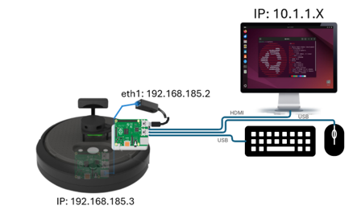
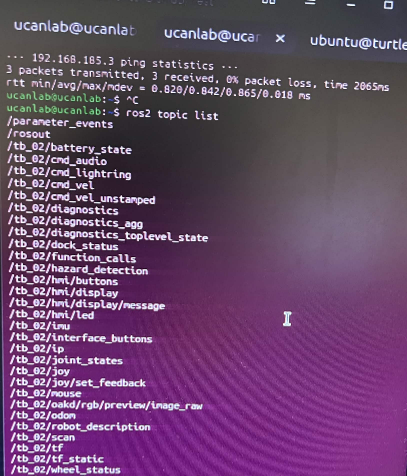

# Setting Up TurtleBot 4

## Overview

This document explains the installation process needed to operate the TurtleBot 4 (TB4) from *Clearpath Robotics*, as well as how to set up the Overhead Pi, which handles communication between the TB4 and the Testbed Controller (TC). With this setup, the Overhead Pi acts as the link between the TB4 and the TC, which lays the groundwork for the multi-node integration introduced in the next chapter.

In this document, we assume the TB4 is fully set up with ROS 2 Jazzy Jalisco (i.e., the Robot Operating System distribution that targets Ubuntu 24.04 LTS) and the Create 3 (i.e., the iRobot mobile base, whose firmware handles the motors, sensors, etc.) [section/link]. The instructions below will be easier to follow if you have read the previous chapters, so we strongly recommend reading the TC chapters (e.g., Chapter 1, Chapter 2) first.

The table below lists the **requirements** (hardware, software, and lab-specific configuration) for the TB4 and the Overhead Pi.

---

## Requirements

|          | Overhead Pi                                                  | TB4's Pi                            |
|   ---    |                     ---                                      |                ---                  |
| Hardware | Raspberry Pi 4 Model B                                       | Raspberry Pi 4 Model B              |
| OS       | Ubuntu Desktop 24.04.5 LTS (64-bit)                          | Ubuntu Server 24.04.5 LTS (64-bit)  |
| Username | ucanlab                                                      | ubuntu                              |
| IP       | 10.1.1.X (lab network), 192.168.185.2 (wired link to TB4)    | 192.168.185.3                       |
| ROS 2    | Jazzy Jalisco                                                | Jazzy    Jalisco                    |

---

## Mobility Architecture

The base mobility architecture is shown below. To stay consistent with our lab's network configuration (see Chapter 2), we keep the usernames and Internet Protocol (IP) addresses fixed: **username: ucanlab**, **IP: 10.1.1.X** for the Overhead Pi, and **username: ubuntu**, **IP: 192.168.185.3** for the TB4's Pi. The primary objective of this chapter is to configure the mobility setup accordingly. We break it into three steps: [(1) flash the micro-SD card with the correct operating system (OS) for the Overhead Pi](#overhead-pi-os-setup), [(2) boot up the Overhead Pi and install all the necessary software](#install-relevant-software), and [(3) establish communication between the Overhead Pi and the TB4's Pi using a USB-to-Ethernet adapter, then verify the connection](#configured-network--verify).



### Overhead Pi OS Setup

ROS 2 Jazzy Jalisco's official binary packages for Ubuntu are built only for Ubuntu 24.04 LTS (codename `noble`), so we need to flash the micro-SD card with a 24.04 release. Any 24.04 point release works (e.g., 24.04.2, 24.04.3, 24.04.4), since point releases are updates of the same `noble` release and use the same package repositories that ROS 2 Jazzy is built against. This document assumes the TB4's Pi runs **Ubuntu Server 24.04.5 LTS (64-bit)**. For the Overhead Pi, we use **Ubuntu Desktop 24.04.5 LTS (64-bit)**, since its graphical interface makes the network and scripting configuration easier to do with a monitor attached. The process is as follows (for more details, look at the figure below):

* Open Raspberry Pi Imager $\rightarrow$ `Device` $\rightarrow$ `Raspberry Pi 4` $\rightarrow$ `OS` $\rightarrow$ `Other general-purpose OS` $\rightarrow$ `Ubuntu` $\rightarrow$ `Ubuntu Desktop 24.04.5 LTS (64-bit)` $\rightarrow$ `Customisation` (e.g., username: ucanlab) $\rightarrow$ `Remote access` (enable SSH) $\rightarrow$ others (e.g., Localisation) $\rightarrow$ `Writing` $\rightarrow$ `Done`.


### Install Relevant Software

After flashing, the Overhead Pi does not have ROS 2 Jazzy Jalisco installed. The Overhead Pi needs ROS 2 to communicate with the TB4 for the following reasons:

- **Communication (DDS):** ROS 2 nodes exchange messages through ROS 2's middleware, the Data Distribution Service (DDS). The Overhead Pi and the TB4 can only discover each other's topics if both run the same ROS 2 distribution (Jazzy), with the same DDS implementation (RMW) and the same `ROS_DOMAIN_ID`.
- **Framework:** ROS 2 is the framework that the TB4's high-level features (e.g., lidar-based mapping (SLAM), navigation (Nav2), camera vision) and our custom Python/C++ scripts are built on. Without it, we cannot complete the setup.
- **Python scripting (`rclpy`):** ROS 2 provides `rclpy`, its client library for Python. Our movement scripts (e.g., `move_forward.py`, `rotate.py`) use `rclpy` to create ROS 2 nodes on the Overhead Pi, publish velocity commands to the TB4 (`/tb_02/cmd_vel_unstamped`), and subscribe to its odometry (`/tb_02/odom`). `rclpy` is included in the `ros-jazzy-ros-base` package installed below.

Before starting the installation, make sure the Pi is booted with a monitor, keyboard, and mouse connected (i.e., as in the image in [Mobility Architecture](#mobility-architecture)), and that it is connected to the Internet, since `apt` needs an Internet connection to download packages and their dependencies. To install everything, follow the two sets of instructions below.

> **Note:** Ubuntu Desktop 24.04.5 LTS (64-bit) does not come with `openssh-server`, which is needed for Secure Shell (SSH) access, so it also needs to be installed.

**1. Install OpenSSH** (for `ssh`, `scp`, etc.)

```bash
sudo apt update
sudo apt install openssh-server
sudo systemctl enable --now ssh.socket ssh
sudo ss -tlnp | grep ':22'                            # optional: check if something is listening
sudo ufw status                                       # optional: check if ufw is active
```

**2. Install ROS 2 Jazzy** (provides DDS communication and `rclpy`)

```bash
sudo apt update
sudo apt install -y software-properties-common curl   # tools for managing 3rd-party repos
sudo add-apt-repository universe                      # enable the universe repo

# Add the ROS 2 apt source
export ROS_APT_SOURCE_VERSION=$(curl -s https://api.github.com/repos/ros-infrastructure/ros-apt-source/releases/latest | grep -F "tag_name" | awk -F\" '{print $4}')
curl -L -o /tmp/ros2-apt-source.deb "https://github.com/ros-infrastructure/ros-apt-source/releases/download/${ROS_APT_SOURCE_VERSION}/ros2-apt-source_${ROS_APT_SOURCE_VERSION}.$(. /etc/os-release && echo $VERSION_CODENAME)_all.deb"
sudo dpkg -i /tmp/ros2-apt-source.deb

# Refresh and install (includes rclpy)
sudo apt update && sudo apt install -y ros-jazzy-ros-base

source /opt/ros/jazzy/setup.bash                      # optional: activate the ROS 2 environment
python3 -c "import rclpy; print('rclpy ok')"          # optional: should print "rclpy ok"
```

### Configured Network & Verify

Currently the Overhead Pi and TB4's Pi still aren't communicative, despite all the softwares have installed. Thus to establish a communication link from Overhead Pi to TB4's Pi, we would need to use direct ethernet wired and a usb-to-ethernet adapter for a fixed usb-wired connection. To proceed with this, open up the `Settings` in the Overhead Pi, and follow the instructions (for more details, look at the figure below): 

* 


the overhead Pi and its robot must be on the same *ROS_DOMAIN_ID*; nodes on different domains cannot see each other. We can manually check or set the TB4's ROS_DOMAIN_ID by SSHing into the TB4's Pi with `ssh ubuntu@192.168.185.3` and typing `echo $ROS_DOMAIN_ID` (i.e., if the terminal prints 0 or nothing, set it using the next command `export ROS_DOMAIN_ID=1`). Then do the same for the overhead Pi, and verify that both have the same domain using `echo $ROS_DOMAIN_ID`. Alternatively, we can use the TB4's GUI by running the command `turtlebot4-setup` (the figure below describes the steps), then set the ROS_DOMAIN_ID to the same number on the overhead Pi.


One thing that can be picked up is the `ROS_DOMAIN_ID` fix for both Overhead Pi and TB4 is not permanent since it we change it in an iterative shells terminal tabs, and every time we close the terminal tab, it will refresh and change everything back to the usual state. Thus to make this a permanent change (visit the debug section). 

After all the packages are installed, we can check whether the overhead Pi is able to see the robot's ROS 2 topics by using the command `ros2 topic list | grep tb_01`. We should see the list of all topics, as shown in the image below.




With that result, we conclude the TB4 setup.

## Next Chapter
[Integrate TB4 to the TC](https://github.com/UCaNLabUMB/Testbed_Controller/blob/main/Documentation/Setup_TC.md)